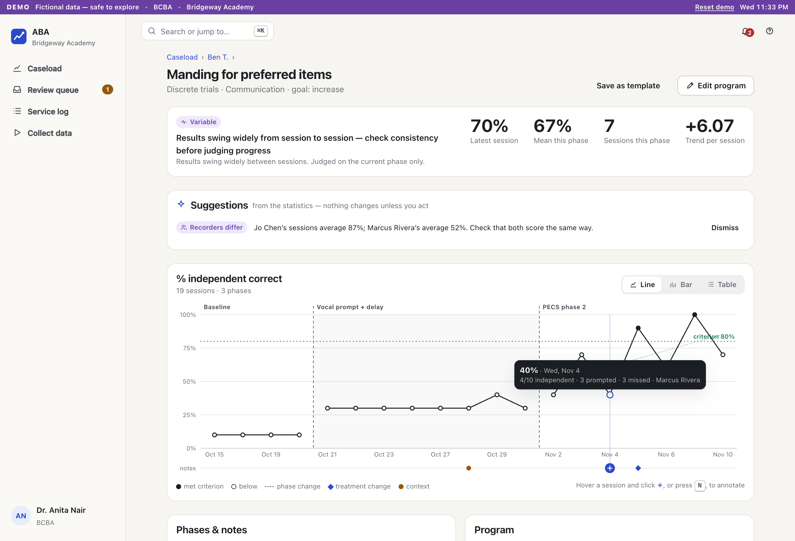

# ABA — data collection & analysis for schools

A working system for Applied Behavior Analysis teams: RBTs record sessions on a phone (online or off), BCBAs see what is working and change course early, families and teachers see what the team shares, school admins manage sites and people, and a system admin runs the platform across schools. Phase 1 is the tested core; Phases 2–4 are first working versions.

> Fictional product built as an evaluation of agentic coding. Not for clinical use.



## Try it (about 2 minutes)
Requires PostgreSQL 14+, Node 20+, [uv](https://docs.astral.sh/uv/).

```bash
make setup     # secrets, databases, schema, demo data, dependencies
make demo      # http://localhost:5173
```

On the sign-in page pick a persona — no password in the Demo environment. Each role offers a one-minute tour. **Reset demo** in the purple bar puts everything back.

| Persona | Role | Start here |
|---|---|---|
| Dr. Anita Nair | BCBA | Caseload → Ben T. → "Manding" graph → hover a session, press **N** |
| Marcus Rivera | RBT | Today → Ben T. → Start session → tap outcomes; try the sync pill's offline switch |
| Linh Tran | Parent | Ben → read the summary, send a count from home |
| Grace Adeyemi | Teacher | Ben → goals and how to support them |
| Priya Raman | School admin (2 sites) | People → Invite parent or teacher; Overview → Optional features |
| Sam Okafor | System admin | Platform health |

Also try as Dr. Nair: "Following group instructions" (a suggested change point), Dee's "Aggression: ABC log", and Ben → Progress report → "Draft with the local model" (needs a local text model: [Ollama](https://ollama.com) with any model, or a llama.cpp `llama-server` with `LLM_URL=http://127.0.0.1:8080` in `.env`). Voice notes are optional: `brew install whisper-cpp`, put `ggml-small.en.bin` in `data/models/whisper/`, add `WHISPER_URL=http://127.0.0.1:8178` to `.env`, run `make speech`, then use Dictate when ending a session as Marcus.

## What is where
```
apps/api/                 FastAPI — one router per responsibility, access rules in deps.py
apps/web/src/shell        sign-in, navigation, help, tours, command palette
apps/web/src/areas/       system · school · clinic · collect · family · shared · design
packages/design-system/   tokens, components, session chart, tour engine
db/                       SQL migrations and the resettable demo seed
docs/                     architecture, ADRs, assumptions, screenshots, slide pack
scripts/                  setup and the end-to-end walkthrough
```

## Documentation
- [Architecture, with diagrams](docs/architecture/README.md) — 13 views from context to a proposed deployment; pictures in `docs/architecture/diagrams/`, generated by `make diagrams`
- [Decisions (ADRs)](docs/adr/README.md) · [Assumptions](docs/ASSUMPTIONS.md) · [Known gaps](docs/GAPS.md) · [Capabilities by role](docs/product/capabilities.md)
- [Slide pack](https://claude.ai/artifact/CajfATRbASCf13ZB8Qpom9) — walkthrough of every capability (private link until shared; source in `docs/slides/`)
- [Guide for coding agents](AGENTS.md)
- [Archive](docs/archive/) — the 2025 spec, the owner's Q&A, and the 2026-10 review that motivated this rework

## Quality
`make test` runs 39 API tests (security, tenancy, sync, analytics, family access, two-factor, media, imports) and the type check. `make screenshots` drives the real app through all six roles and regenerates the 78 images in `docs/screenshots/`.
