# Architecture

Thirteen views, from the outside in. Every diagram lives in [`diagrams/`](diagrams/) as an SVG (for docs) and a PNG (for slides), and is generated from [`scripts/diagrams.py`](../../scripts/diagrams.py) by `make diagrams` — edit the script, not the picture.

| # | View | Answers |
|---|---|---|
| 1 | Context | Who uses it? |
| 2 | Containers | What are the main parts? |
| 3 | Responsibilities | Where does each concern live? |
| 4 | Data model | What is stored? |
| 5 | Sync and lock | How does offline recording stay safe? |
| 6 | Security | What protects the data? |
| 7 | Local models | Which models run, and what guards them? |
| 8 | Derived facts | How does a tap become a graph, report or family page? |
| 9 | Runtime | Which processes, ports, settings and files? |
| 10 | Sign-in and two-factor | What happens at sign-in? |
| 11 | Consent and media | When may a photo or video be stored? |
| 12 | Notifications | Who is told about what? |
| 13 | Deployment (proposed) | What would production need? | Decisions behind each view are in the [ADRs](../adr/README.md).

## 1 · Context — who uses it
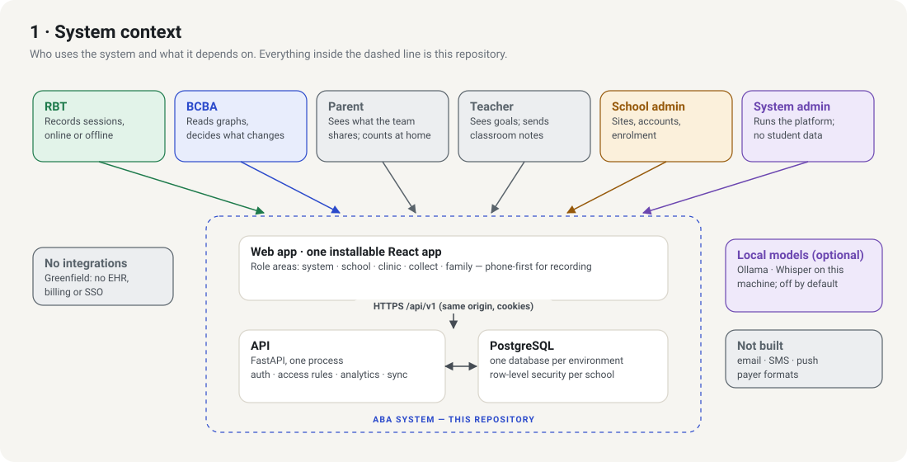

Six roles, one system, no integrations. System admins operate the platform across schools; inside a school, admins manage people and enrolment, the clinical team (BCBA, RBT) works with student data, and parents and teachers see what the BCBA shares.

## 2 · Containers — what runs
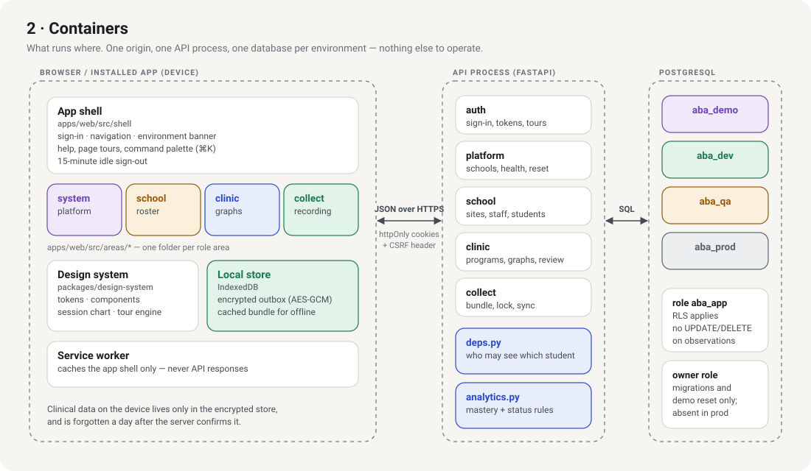

One web app, one API process, one PostgreSQL database per environment — plus two optional local-model helpers (view 7). The browser talks to a single origin; in development Vite proxies `/api` to the API, in production the API serves the built app. → [ADR-0002](../adr/0002-modular-monolith-sql-first.md), [ADR-0005](../adr/0005-offline-first-web-app.md), [ADR-0008](../adr/0008-environments-and-demo-reset.md)

## 3 · Responsibilities — where things live
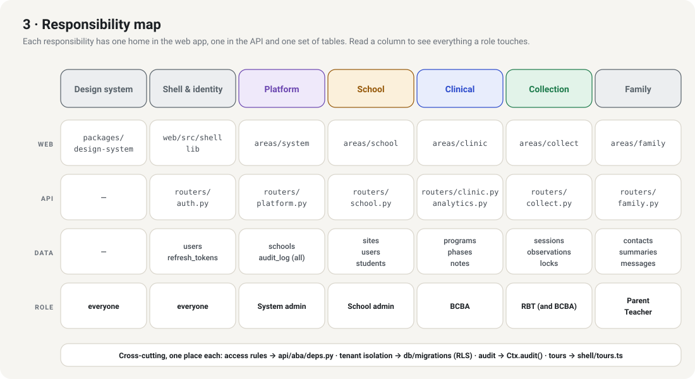

The same split appears three times — folder in the web app, router in the API, tables in the database — so "who owns this?" has one answer. → [ADR-0009](../adr/0009-design-system-package.md), [AGENTS.md](../../AGENTS.md)

## 4 · Data — what is stored
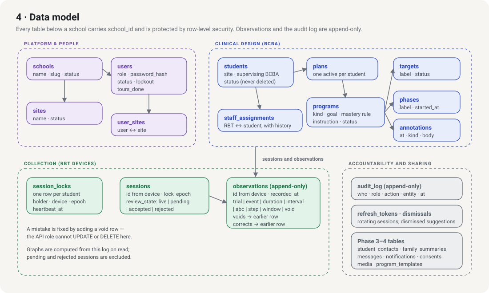

Schema: [`db/migrations/001_init.sql`](../../db/migrations/001_init.sql). Two properties matter most: every school-owned row is fenced by row-level security, and observations are an append-only log from which graphs are computed. → [ADR-0003](../adr/0003-tenancy-and-row-level-security.md), [ADR-0004](../adr/0004-append-only-observations.md)

## 5 · Behaviour — offline sync and the session lock
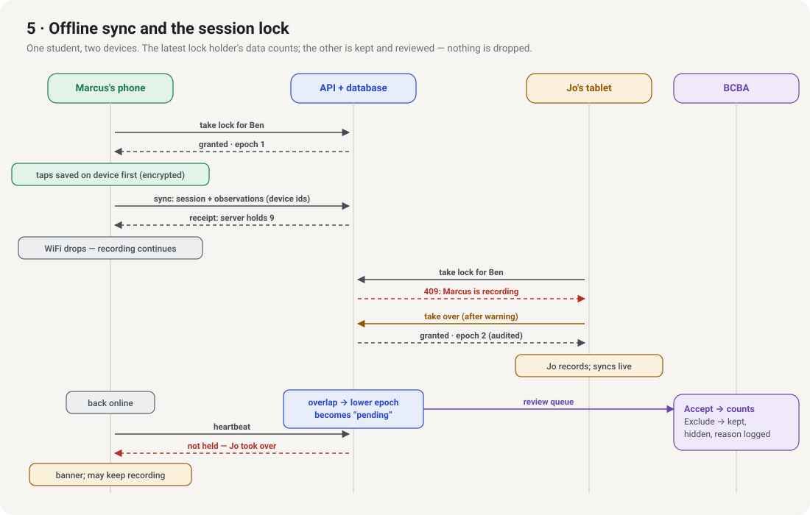

The riskiest behaviour in the system, covered by `tests/test_collect.py` and by the two-device part of the walkthrough. → [ADR-0006](../adr/0006-session-lock-and-review-queue.md)

**Request lifecycle (every API call):** cookie → verify JWT → open one transaction → set `app.role / app.school_id / app.user_id` → re-read the user (active? same role?) → role check → student-scope check → SQL (RLS applies) → audit row → commit.

## 6 · Security — defence in depth
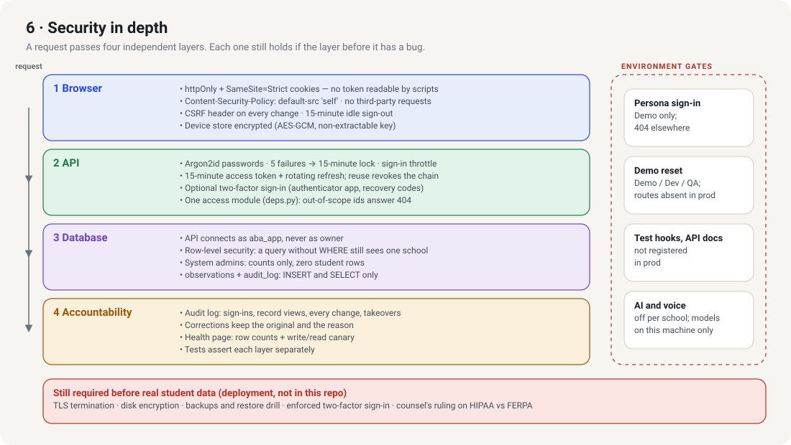

→ [ADR-0007](../adr/0007-authentication-and-sessions.md). What is *not* yet covered is listed in the red box and in [GAPS.md](../GAPS.md).

## 7 · Local models — optional helpers
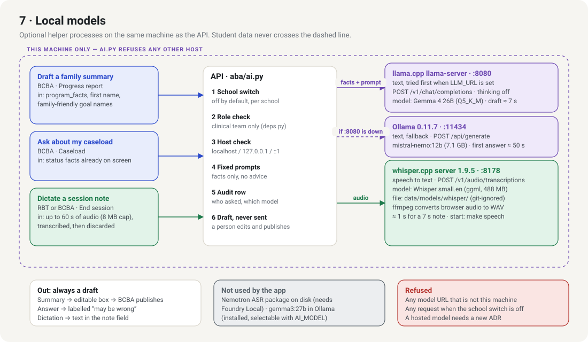

Text goes to a llama.cpp server (Gemma 4 26B) when `LLM_URL` is set and running, otherwise to Ollama (`mistral-nemo:12b`); speech goes to a whisper.cpp server (Whisper `small.en`). All listen on localhost and `aba/ai.py` refuses any other host. Six gates sit between a click and a model, and every output is a draft. Versions, sizes and why each was chosen: [ADR-0014](../adr/0014-local-models-only.md).

## 8 · Derived facts — from a tap to what people read
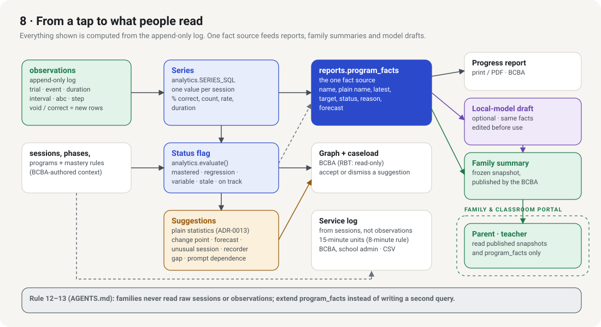

Nothing on a graph, report or family page is stored as a result; it is computed from the observation log each time. `reports.program_facts` is the single source for the progress report, family summaries and model drafts, and the only clinical data a parent or teacher can reach. → [ADR-0010](../adr/0010-clinical-decision-rules.md), [ADR-0013](../adr/0013-statistical-insights.md), [ADR-0015](../adr/0015-family-and-classroom-access.md), [ADR-0017](../adr/0017-reports-and-service-log.md)

## 9 · Runtime — processes, ports and files
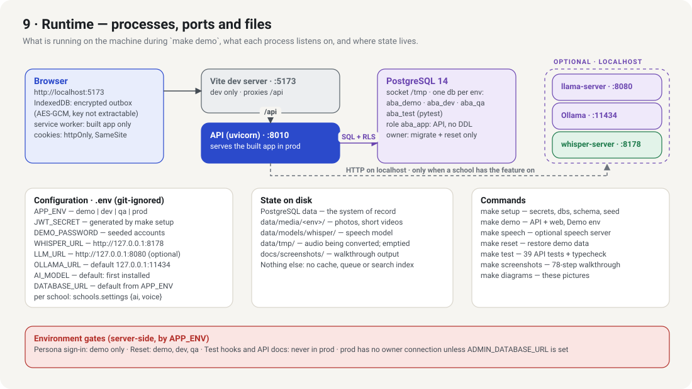

What listens where during `make demo`, every setting the API reads, and where state lives on disk. → [ADR-0008](../adr/0008-environments-and-demo-reset.md), [ASSUMPTIONS](../ASSUMPTIONS.md) E3 and E6

## 10 · Sign-in and two-factor
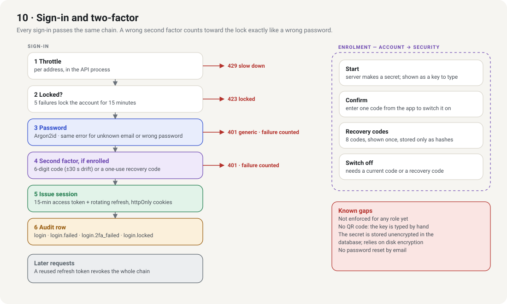

One chain for every sign-in; a wrong second factor counts toward the lock like a wrong password. → [ADR-0007](../adr/0007-authentication-and-sessions.md), [ADR-0018](../adr/0018-two-factor-sign-in.md)

## 11 · Consent and media
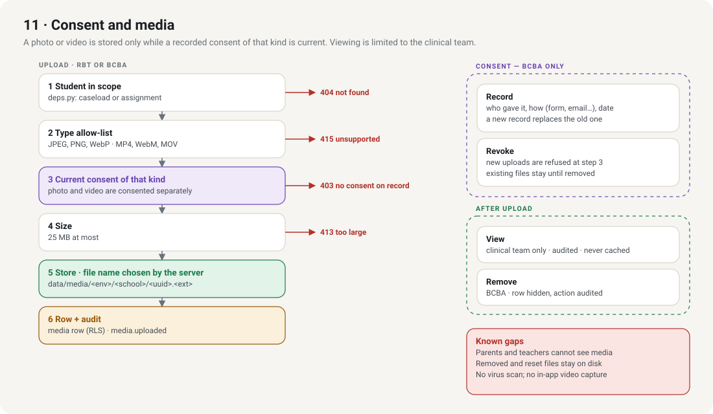

Photo and video are consented separately, and an upload is refused unless that consent is current. → [ADR-0016](../adr/0016-consent-and-media.md)

## 12 · Notifications
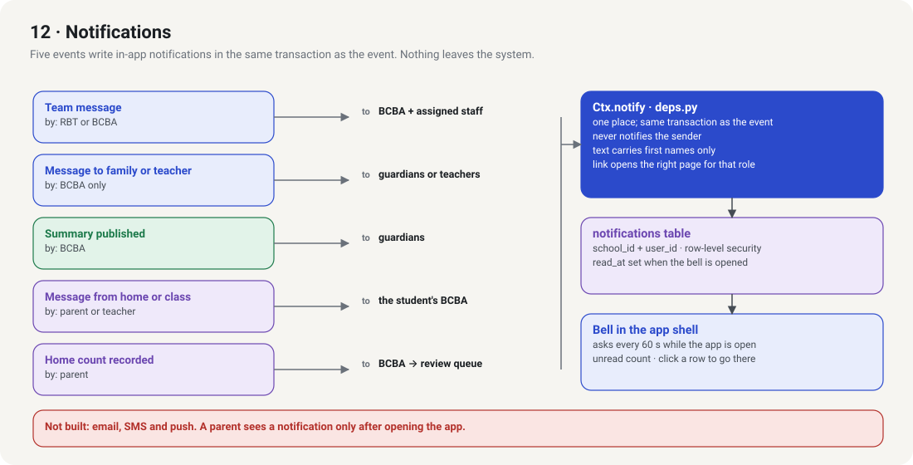

Five events, one function (`Ctx.notify` in `deps.py`), one table, one bell. In-app only. → [ADR-0015](../adr/0015-family-and-classroom-access.md)

## 13 · Deployment — proposed, not built
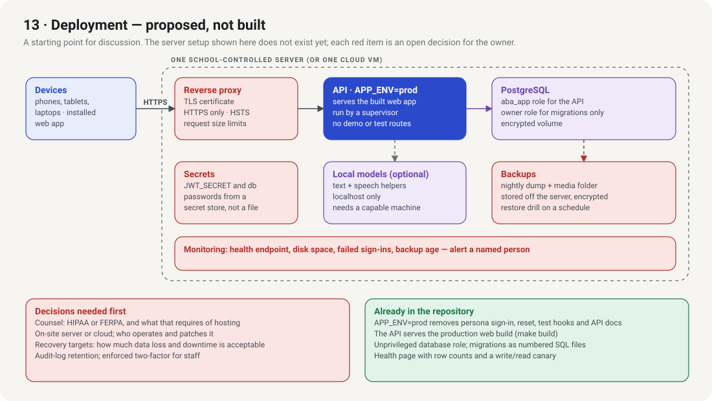

A starting point for discussion, not a description of something that exists. The red boxes are the work and decisions listed in [GAPS.md](../GAPS.md); when the owner decides, record it as a new ADR and redraw this view.

## Numbers
| | |
|---|---|
| API | ~2,800 lines Python, 8 routers, 39 tests |
| Web | ~2,900 lines TypeScript, 6 role areas |
| Design system | ~1,000 lines, 0 runtime dependencies beyond React |
| Database | 24 tables, 7 migrations, 1 seed |
| Runtime dependencies | FastAPI, psycopg, argon2, PyJWT · React, React Router |
