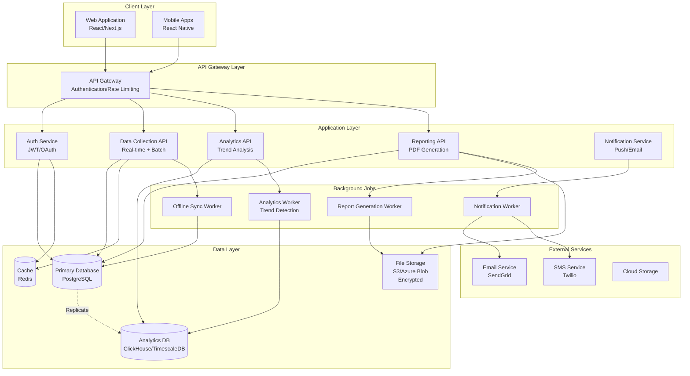
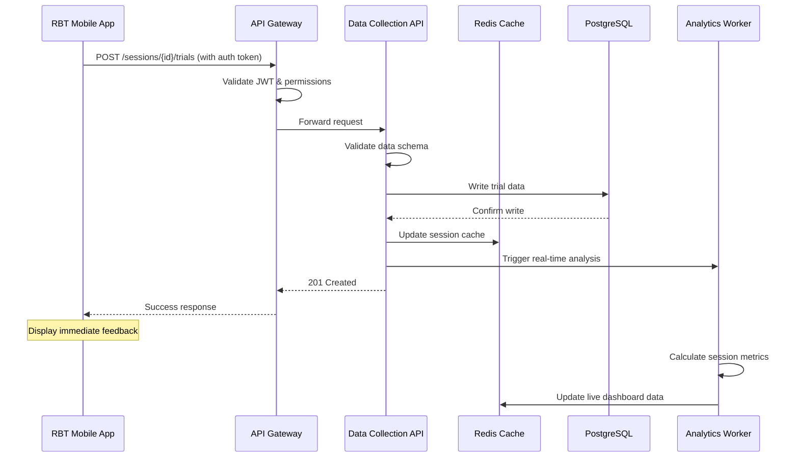
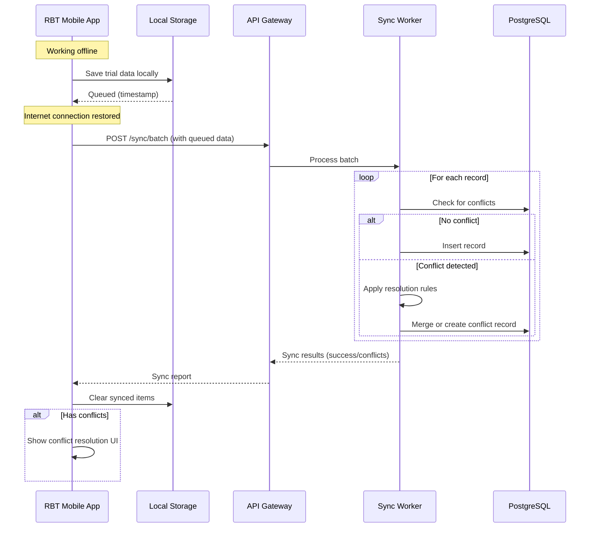
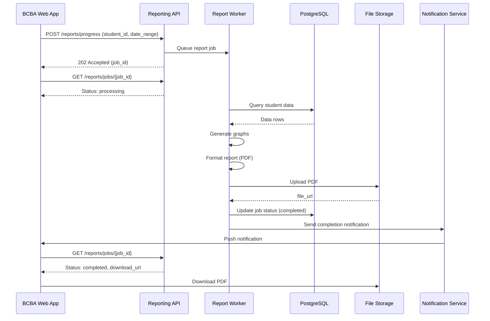
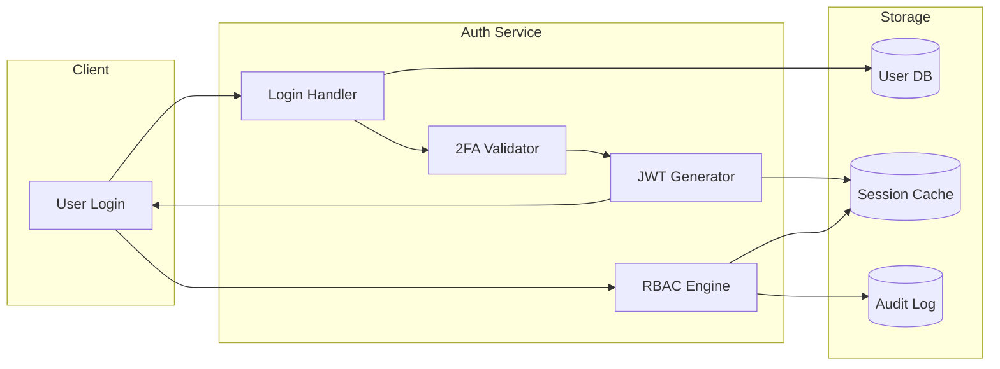
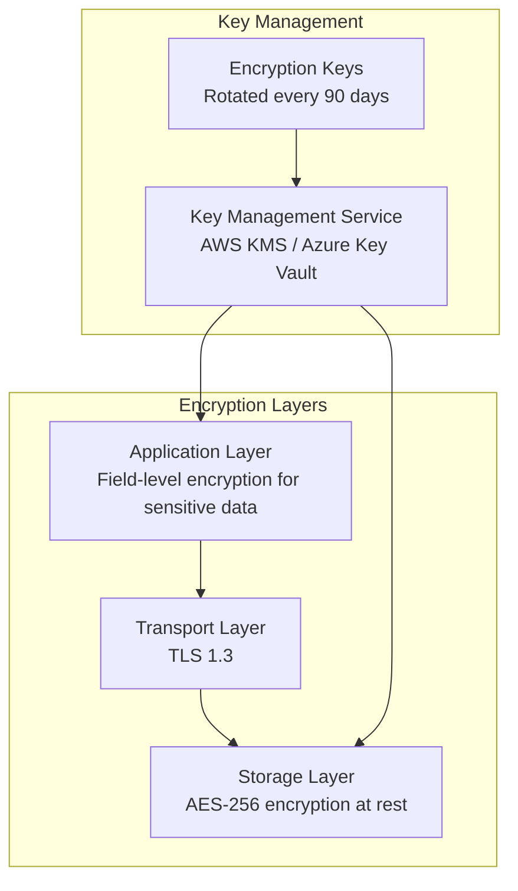
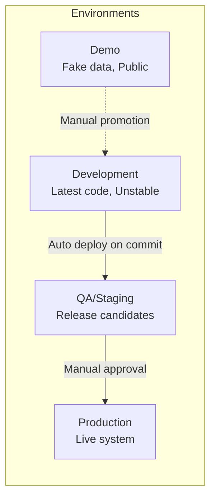

# System Architecture

## High-Level Architecture

## System Components

### Client Applications

#### Web Application
- **Technology**: React with Next.js (SSR/SSG)
- **Purpose**: Full-featured interface for BCBAs, Admins, Parents
- **Key Features**:
  - Rich data visualization (graphs, reports)
  - Program management interface
  - User administration
  - Report generation and export

#### Mobile Applications
- **Technology**: React Native (iOS/Android)
- **Purpose**: Field data collection for RBTs
- **Key Features**:
  - Offline-first data collection
  - Voice-to-text input
  - Camera integration
  - Timer/stopwatch functionality
  - Haptic feedback

### Backend Services

#### Authentication Service
- User authentication (JWT tokens)
- Role-based access control (RBAC)
- Two-factor authentication (2FA)
- Session management
- Audit logging

#### Data Collection API
- Real-time data ingestion
- Batch data processing
- Data validation
- Conflict resolution for offline sync
- Version control for concurrent edits

#### Analytics API
- Statistical analysis
- Trend detection (regression, no progress, mastery)
- Phase change detection
- Predictive analytics
- Aggregation and summarization

#### Reporting API
- Progress report generation
- Insurance report formatting
- Parent summary generation
- Custom report builder
- PDF/Excel export

#### Notification Service
- Push notifications (mobile)
- Email notifications
- SMS notifications (optional)
- In-app notifications
- Notification preferences management

### Data Storage

#### Primary Database (PostgreSQL)
- **Purpose**: Transactional data
- **Data**:
  - User accounts and profiles
  - Student records (PHI)
  - Treatment plans and programs
  - Data collection records
  - Session information
- **Features**:
  - ACID compliance
  - Row-level security
  - Encryption at rest
  - Point-in-time recovery
  - Automated backups

#### Cache Layer (Redis)
- **Purpose**: Performance optimization
- **Data**:
  - Session tokens
  - Frequently accessed student data
  - Real-time counters
  - Rate limiting data
- **Features**:
  - Sub-millisecond latency
  - Pub/sub for real-time updates
  - TTL-based expiration

#### Analytics Database (TimescaleDB/ClickHouse)
- **Purpose**: Time-series data analysis
- **Data**:
  - Historical data points
  - Aggregated metrics
  - Trend analysis results
- **Features**:
  - Optimized for time-series queries
  - Automatic data retention policies
  - Materialized views for performance

#### File Storage (S3/Azure Blob)
- **Purpose**: Large file storage
- **Data**:
  - Session videos
  - Photos
  - Generated reports (PDFs)
  - Data exports
- **Features**:
  - Encryption at rest and in transit
  - Versioning
  - Lifecycle policies
  - CDN integration

### Background Workers

#### Offline Sync Worker
- Processes offline data uploads
- Resolves conflicts
- Validates data integrity
- Updates cache and analytics

#### Analytics Worker
- Runs statistical analyses
- Detects trends and anomalies
- Generates alerts
- Updates dashboards

#### Report Generation Worker
- Generates scheduled reports
- Processes bulk exports
- Creates visualizations
- Sends notifications

#### Notification Worker
- Queues and dispatches notifications
- Handles retry logic
- Tracks delivery status
- Manages user preferences

## Data Flow Patterns

### Real-Time Data Collection Flow

### Offline Sync Flow

### Report Generation Flow

## Security Architecture

### Authentication & Authorization Flow

### Data Encryption

## Scalability Strategy

### Horizontal Scaling

- **API Services**: Stateless, can scale horizontally behind load balancer
- **Background Workers**: Queue-based, can add workers as needed
- **Database**: Read replicas for analytics queries
- **Cache**: Redis Cluster for distributed caching

### Vertical Scaling

- **Database**: Scale up for transaction throughput
- **Analytics DB**: Scale up for complex queries

### Performance Targets

| Metric | Target | Notes |
|--------|--------|-------|
| API Response Time (p95) | < 200ms | Cached endpoints |
| API Response Time (p95) | < 500ms | Database queries |
| Data Collection Write | < 100ms | Critical path |
| Offline Sync Processing | < 5s per 100 records | Background |
| Report Generation | < 30s | Small reports (< 1 month) |
| Report Generation | < 2min | Large reports (> 3 months) |
| Mobile App Launch | < 2s | Cold start |
| Graph Rendering | < 1s | Up to 1000 data points |

## Deployment Architecture

### Environment Structure

### Infrastructure Components

- **Container Orchestration**: Kubernetes / ECS
- **Load Balancer**: Application Load Balancer (ALB)
- **CDN**: CloudFront / Azure CDN
- **Monitoring**: Prometheus + Grafana
- **Logging**: ELK Stack / CloudWatch
- **Secrets Management**: AWS Secrets Manager / Azure Key Vault

## Technology Stack Recommendations

### Frontend
- **Web**: React 18+, Next.js 14+, TypeScript, TailwindCSS
- **Mobile**: React Native, TypeScript, Expo
- **State Management**: Zustand / Jotai (lightweight)
- **Forms**: React Hook Form
- **Graphs**: Recharts / Victory Native

### Backend
- **API Framework**: Node.js (Fastify) or Python (FastAPI)
- **Language**: TypeScript (Node.js) or Python 3.11+
- **Validation**: Zod (TS) or Pydantic (Python)
- **ORM**: Prisma (TS) or SQLAlchemy (Python)

### Database
- **Primary**: PostgreSQL 15+ with TimescaleDB extension
- **Cache**: Redis 7+
- **File Storage**: AWS S3 / Azure Blob Storage

### Infrastructure
- **Cloud Provider**: AWS or Azure
- **IaC**: Terraform
- **CI/CD**: GitHub Actions
- **Containers**: Docker

### Rationale for Stack

**React Native for Mobile**:
- Single codebase for iOS/Android
- Direct access to native APIs (camera, voice, haptics)
- Rich ecosystem for offline-first apps
- Expo for easier deployment and OTA updates

**PostgreSQL with TimescaleDB**:
- Robust ACID guarantees for PHI
- Excellent support for time-series data
- Powerful JSON support for flexible schemas
- Strong security features (RLS, encryption)

**Node.js/TypeScript OR Python**:
- Node.js: Better for real-time features, shared code with frontend
- Python: Better for data analysis, ML capabilities
- Both have excellent HIPAA-compliant libraries

---

**Next**: See [ADR Index](./adr/README.md) for detailed architectural decisions.
