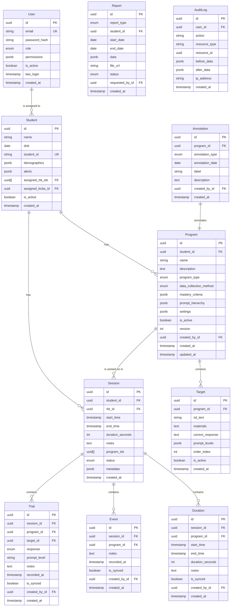

# Data Models

Database schema and entity relationships for the ABA system.

## Entity Relationship Diagram



## Core Entities

### User

Represents all system users (Admin, BCBA, RBT, Parent, School Staff).

```sql
CREATE TABLE users (
    id UUID PRIMARY KEY DEFAULT gen_random_uuid(),
    email VARCHAR(255) UNIQUE NOT NULL,
    password_hash VARCHAR(255) NOT NULL,
    role VARCHAR(50) NOT NULL CHECK (role IN ('admin', 'bcba', 'rbt', 'parent', 'school_staff')),
    permissions JSONB DEFAULT '[]',
    first_name VARCHAR(100),
    last_name VARCHAR(100),
    phone VARCHAR(20),
    is_active BOOLEAN DEFAULT true,
    two_factor_enabled BOOLEAN DEFAULT false,
    two_factor_secret VARCHAR(255),
    last_login TIMESTAMPTZ,
    login_attempts INT DEFAULT 0,
    locked_until TIMESTAMPTZ,
    created_at TIMESTAMPTZ DEFAULT NOW(),
    updated_at TIMESTAMPTZ DEFAULT NOW()
);

CREATE INDEX idx_users_email ON users(email);
CREATE INDEX idx_users_role ON users(role);
CREATE INDEX idx_users_is_active ON users(is_active);
```

**TypeScript Interface**:
```typescript
interface User {
  id: string;
  email: string;
  password_hash: string;
  role: 'admin' | 'bcba' | 'rbt' | 'parent' | 'school_staff';
  permissions: Permission[];
  first_name?: string;
  last_name?: string;
  phone?: string;
  is_active: boolean;
  two_factor_enabled: boolean;
  two_factor_secret?: string;
  last_login?: Date;
  login_attempts: number;
  locked_until?: Date;
  created_at: Date;
  updated_at: Date;
}

type Permission = 
  | 'view_student'
  | 'edit_student'
  | 'create_program'
  | 'edit_program'
  | 'view_all_students'
  | 'manage_users'
  | 'view_reports'
  | 'export_data'
  | 'manage_system';
```

---

### Student

Represents students receiving ABA services.

```sql
CREATE TABLE students (
    id UUID PRIMARY KEY DEFAULT gen_random_uuid(),
    name VARCHAR(255) NOT NULL,
    dob DATE NOT NULL,
    student_id VARCHAR(50) UNIQUE,
    demographics JSONB DEFAULT '{}',
    alerts JSONB DEFAULT '[]',
    assigned_bcba_id UUID REFERENCES users(id),
    assigned_rbt_ids UUID[] DEFAULT '{}',
    photo_consent BOOLEAN DEFAULT false,
    video_consent BOOLEAN DEFAULT false,
    is_active BOOLEAN DEFAULT true,
    created_at TIMESTAMPTZ DEFAULT NOW(),
    updated_at TIMESTAMPTZ DEFAULT NOW(),
    
    CONSTRAINT students_bcba_role CHECK (
        assigned_bcba_id IS NULL OR 
        EXISTS (SELECT 1 FROM users WHERE id = assigned_bcba_id AND role = 'bcba')
    )
);

CREATE INDEX idx_students_student_id ON students(student_id);
CREATE INDEX idx_students_bcba ON students(assigned_bcba_id);
CREATE INDEX idx_students_is_active ON students(is_active);
CREATE INDEX idx_students_rbt_ids ON students USING GIN(assigned_rbt_ids);
```

**TypeScript Interface**:
```typescript
interface Student {
  id: string;
  name: string;
  dob: Date;
  student_id?: string;
  demographics: {
    gender?: string;
    grade?: string;
    primary_language?: string;
    [key: string]: any;
  };
  alerts: Alert[];
  assigned_bcba_id?: string;
  assigned_rbt_ids: string[];
  photo_consent: boolean;
  video_consent: boolean;
  is_active: boolean;
  created_at: Date;
  updated_at: Date;
}

interface Alert {
  type: 'medical' | 'behavioral' | 'other';
  severity: 'low' | 'medium' | 'high';
  description: string;
  created_at: Date;
}
```

---

### Program

Represents a behavioral or skill acquisition program for a student.

```sql
CREATE TYPE program_type AS ENUM ('skill_acquisition', 'behavior_reduction', 'mixed');
CREATE TYPE data_collection_method AS ENUM ('trial', 'frequency', 'duration', 'interval', 'abc', 'task_analysis', 'probe');

CREATE TABLE programs (
    id UUID PRIMARY KEY DEFAULT gen_random_uuid(),
    student_id UUID NOT NULL REFERENCES students(id) ON DELETE CASCADE,
    name VARCHAR(255) NOT NULL,
    description TEXT,
    program_type program_type NOT NULL,
    data_collection_method data_collection_method NOT NULL,
    mastery_criteria JSONB NOT NULL DEFAULT '{}',
    prompt_hierarchy JSONB DEFAULT '[]',
    reinforcement_schedule TEXT,
    error_correction TEXT,
    settings JSONB DEFAULT '{}',
    is_active BOOLEAN DEFAULT true,
    version INT DEFAULT 1,
    parent_version_id UUID REFERENCES programs(id),
    created_by_id UUID REFERENCES users(id),
    created_at TIMESTAMPTZ DEFAULT NOW(),
    updated_at TIMESTAMPTZ DEFAULT NOW()
);

CREATE INDEX idx_programs_student ON programs(student_id);
CREATE INDEX idx_programs_is_active ON programs(is_active);
CREATE INDEX idx_programs_created_by ON programs(created_by_id);
```

**TypeScript Interface**:
```typescript
interface Program {
  id: string;
  student_id: string;
  name: string;
  description?: string;
  program_type: 'skill_acquisition' | 'behavior_reduction' | 'mixed';
  data_collection_method: 'trial' | 'frequency' | 'duration' | 'interval' | 'abc' | 'task_analysis' | 'probe';
  mastery_criteria: MasteryCriteria;
  prompt_hierarchy?: string[];
  reinforcement_schedule?: string;
  error_correction?: string;
  settings: ProgramSettings;
  is_active: boolean;
  version: number;
  parent_version_id?: string;
  created_by_id?: string;
  created_at: Date;
  updated_at: Date;
}

interface MasteryCriteria {
  type: 'consecutive_sessions' | 'percentage' | 'custom';
  threshold: number; // e.g., 80 for 80%
  sessions?: number; // e.g., 3 for 3 consecutive sessions
  description?: string;
}

interface ProgramSettings {
  target_rotation?: 'random' | 'sequential' | 'manual';
  trials_per_target?: number;
  interval_length?: number; // seconds, for interval recording
  [key: string]: any;
}
```

---

### Target

Individual teaching targets within a program.

```sql
CREATE TABLE targets (
    id UUID PRIMARY KEY DEFAULT gen_random_uuid(),
    program_id UUID NOT NULL REFERENCES programs(id) ON DELETE CASCADE,
    sd_text TEXT NOT NULL,
    materials TEXT,
    correct_response TEXT NOT NULL,
    prompt_levels JSONB DEFAULT '[]',
    order_index INT NOT NULL,
    is_active BOOLEAN DEFAULT true,
    created_at TIMESTAMPTZ DEFAULT NOW(),
    updated_at TIMESTAMPTZ DEFAULT NOW()
);

CREATE INDEX idx_targets_program ON targets(program_id);
CREATE INDEX idx_targets_is_active ON targets(is_active);
CREATE UNIQUE INDEX idx_targets_program_order ON targets(program_id, order_index);
```

**TypeScript Interface**:
```typescript
interface Target {
  id: string;
  program_id: string;
  sd_text: string; // Discriminative stimulus
  materials?: string;
  correct_response: string;
  prompt_levels: PromptLevel[];
  order_index: number;
  is_active: boolean;
  created_at: Date;
  updated_at: Date;
}

interface PromptLevel {
  level: number;
  name: string; // e.g., "Independent", "Verbal", "Model", "Physical"
  description: string;
}
```

---

### Session

Represents a data collection session with a student.

```sql
CREATE TYPE session_status AS ENUM ('active', 'paused', 'completed', 'cancelled');

CREATE TABLE sessions (
    id UUID PRIMARY KEY DEFAULT gen_random_uuid(),
    student_id UUID NOT NULL REFERENCES students(id) ON DELETE CASCADE,
    rbt_id UUID NOT NULL REFERENCES users(id),
    program_ids UUID[] DEFAULT '{}',
    start_time TIMESTAMPTZ NOT NULL,
    end_time TIMESTAMPTZ,
    duration_seconds INT,
    notes TEXT,
    status session_status DEFAULT 'active',
    metadata JSONB DEFAULT '{}',
    created_at TIMESTAMPTZ DEFAULT NOW(),
    updated_at TIMESTAMPTZ DEFAULT NOW()
);

CREATE INDEX idx_sessions_student ON sessions(student_id);
CREATE INDEX idx_sessions_rbt ON sessions(rbt_id);
CREATE INDEX idx_sessions_start_time ON sessions(start_time);
CREATE INDEX idx_sessions_status ON sessions(status);
CREATE INDEX idx_sessions_program_ids ON sessions USING GIN(program_ids);
```

**TypeScript Interface**:
```typescript
interface Session {
  id: string;
  student_id: string;
  rbt_id: string;
  program_ids: string[];
  start_time: Date;
  end_time?: Date;
  duration_seconds?: number;
  notes?: string;
  status: 'active' | 'paused' | 'completed' | 'cancelled';
  metadata: {
    location?: string;
    interruptions?: number;
    [key: string]: any;
  };
  created_at: Date;
  updated_at: Date;
}
```

---

### Trial

Individual trial data for discrete trial training.

```sql
CREATE TYPE trial_response AS ENUM ('correct', 'prompted', 'incorrect', 'no_response');

CREATE TABLE trials (
    id UUID PRIMARY KEY DEFAULT gen_random_uuid(),
    session_id UUID NOT NULL REFERENCES sessions(id) ON DELETE CASCADE,
    program_id UUID NOT NULL REFERENCES programs(id),
    target_id UUID NOT NULL REFERENCES targets(id),
    response trial_response NOT NULL,
    prompt_level VARCHAR(50),
    notes TEXT,
    recorded_at TIMESTAMPTZ NOT NULL,
    is_synced BOOLEAN DEFAULT true,
    offline_id VARCHAR(100), -- Local ID for offline tracking
    created_by_id UUID REFERENCES users(id),
    created_at TIMESTAMPTZ DEFAULT NOW()
);

CREATE INDEX idx_trials_session ON trials(session_id);
CREATE INDEX idx_trials_program ON trials(program_id);
CREATE INDEX idx_trials_target ON trials(target_id);
CREATE INDEX idx_trials_recorded_at ON trials(recorded_at);
CREATE INDEX idx_trials_is_synced ON trials(is_synced) WHERE is_synced = false;
```

**TypeScript Interface**:
```typescript
interface Trial {
  id: string;
  session_id: string;
  program_id: string;
  target_id: string;
  response: 'correct' | 'prompted' | 'incorrect' | 'no_response';
  prompt_level?: string;
  notes?: string;
  recorded_at: Date;
  is_synced: boolean;
  offline_id?: string;
  created_by_id?: string;
  created_at: Date;
}
```

---

### Event

Frequency/event data points.

```sql
CREATE TABLE events (
    id UUID PRIMARY KEY DEFAULT gen_random_uuid(),
    session_id UUID NOT NULL REFERENCES sessions(id) ON DELETE CASCADE,
    program_id UUID NOT NULL REFERENCES programs(id),
    notes TEXT,
    recorded_at TIMESTAMPTZ NOT NULL,
    is_synced BOOLEAN DEFAULT true,
    offline_id VARCHAR(100),
    created_by_id UUID REFERENCES users(id),
    created_at TIMESTAMPTZ DEFAULT NOW()
);

CREATE INDEX idx_events_session ON events(session_id);
CREATE INDEX idx_events_program ON events(program_id);
CREATE INDEX idx_events_recorded_at ON events(recorded_at);
CREATE INDEX idx_events_is_synced ON events(is_synced) WHERE is_synced = false;
```

**TypeScript Interface**:
```typescript
interface Event {
  id: string;
  session_id: string;
  program_id: string;
  notes?: string;
  recorded_at: Date;
  is_synced: boolean;
  offline_id?: string;
  created_by_id?: string;
  created_at: Date;
}
```

---

### Duration

Duration recording data.

```sql
CREATE TABLE durations (
    id UUID PRIMARY KEY DEFAULT gen_random_uuid(),
    session_id UUID NOT NULL REFERENCES sessions(id) ON DELETE CASCADE,
    program_id UUID NOT NULL REFERENCES programs(id),
    start_time TIMESTAMPTZ NOT NULL,
    end_time TIMESTAMPTZ NOT NULL,
    duration_seconds INT NOT NULL,
    notes TEXT,
    is_synced BOOLEAN DEFAULT true,
    offline_id VARCHAR(100),
    created_by_id UUID REFERENCES users(id),
    created_at TIMESTAMPTZ DEFAULT NOW()
);

CREATE INDEX idx_durations_session ON durations(session_id);
CREATE INDEX idx_durations_program ON durations(program_id);
CREATE INDEX idx_durations_start_time ON durations(start_time);
CREATE INDEX idx_durations_is_synced ON durations(is_synced) WHERE is_synced = false;
```

**TypeScript Interface**:
```typescript
interface Duration {
  id: string;
  session_id: string;
  program_id: string;
  start_time: Date;
  end_time: Date;
  duration_seconds: number;
  notes?: string;
  is_synced: boolean;
  offline_id?: string;
  created_by_id?: string;
  created_at: Date;
}
```

---

### Annotation

Graph annotations (phase changes, interventions).

```sql
CREATE TYPE annotation_type AS ENUM ('phase_change', 'intervention', 'note', 'alert');

CREATE TABLE annotations (
    id UUID PRIMARY KEY DEFAULT gen_random_uuid(),
    program_id UUID NOT NULL REFERENCES programs(id) ON DELETE CASCADE,
    annotation_type annotation_type NOT NULL,
    annotation_date DATE NOT NULL,
    label VARCHAR(255) NOT NULL,
    description TEXT,
    color VARCHAR(7), -- Hex color code
    created_by_id UUID REFERENCES users(id),
    created_at TIMESTAMPTZ DEFAULT NOW()
);

CREATE INDEX idx_annotations_program ON annotations(program_id);
CREATE INDEX idx_annotations_date ON annotations(annotation_date);
```

**TypeScript Interface**:
```typescript
interface Annotation {
  id: string;
  program_id: string;
  annotation_type: 'phase_change' | 'intervention' | 'note' | 'alert';
  annotation_date: Date;
  label: string;
  description?: string;
  color?: string;
  created_by_id?: string;
  created_at: Date;
}
```

---

### Report

Generated reports.

```sql
CREATE TYPE report_type AS ENUM ('progress', 'insurance', 'parent', 'custom');
CREATE TYPE report_status AS ENUM ('pending', 'processing', 'completed', 'failed');

CREATE TABLE reports (
    id UUID PRIMARY KEY DEFAULT gen_random_uuid(),
    report_type report_type NOT NULL,
    student_id UUID REFERENCES students(id) ON DELETE CASCADE,
    start_date DATE NOT NULL,
    end_date DATE NOT NULL,
    data JSONB NOT NULL DEFAULT '{}',
    file_url VARCHAR(500),
    status report_status DEFAULT 'pending',
    error_message TEXT,
    requested_by_id UUID REFERENCES users(id),
    created_at TIMESTAMPTZ DEFAULT NOW(),
    updated_at TIMESTAMPTZ DEFAULT NOW()
);

CREATE INDEX idx_reports_student ON reports(student_id);
CREATE INDEX idx_reports_requested_by ON reports(requested_by_id);
CREATE INDEX idx_reports_status ON reports(status);
CREATE INDEX idx_reports_created_at ON reports(created_at);
```

**TypeScript Interface**:
```typescript
interface Report {
  id: string;
  report_type: 'progress' | 'insurance' | 'parent' | 'custom';
  student_id?: string;
  start_date: Date;
  end_date: Date;
  data: ReportData;
  file_url?: string;
  status: 'pending' | 'processing' | 'completed' | 'failed';
  error_message?: string;
  requested_by_id?: string;
  created_at: Date;
  updated_at: Date;
}

interface ReportData {
  programs?: ProgramSummary[];
  graphs?: GraphData[];
  narrative?: string;
  [key: string]: any;
}
```

---

### AuditLog

Tracks all PHI access and modifications for HIPAA compliance.

```sql
CREATE TABLE audit_logs (
    id UUID PRIMARY KEY DEFAULT gen_random_uuid(),
    user_id UUID REFERENCES users(id),
    action VARCHAR(100) NOT NULL,
    resource_type VARCHAR(50) NOT NULL,
    resource_id UUID,
    before_data JSONB,
    after_data JSONB,
    ip_address INET,
    user_agent TEXT,
    created_at TIMESTAMPTZ DEFAULT NOW()
);

CREATE INDEX idx_audit_logs_user ON audit_logs(user_id);
CREATE INDEX idx_audit_logs_resource ON audit_logs(resource_type, resource_id);
CREATE INDEX idx_audit_logs_action ON audit_logs(action);
CREATE INDEX idx_audit_logs_created_at ON audit_logs(created_at);

-- Partition by month for performance
CREATE TABLE audit_logs_2024_01 PARTITION OF audit_logs
    FOR VALUES FROM ('2024-01-01') TO ('2024-02-01');
-- ... create partitions for each month
```

**TypeScript Interface**:
```typescript
interface AuditLog {
  id: string;
  user_id?: string;
  action: string;
  resource_type: string;
  resource_id?: string;
  before_data?: Record<string, any>;
  after_data?: Record<string, any>;
  ip_address?: string;
  user_agent?: string;
  created_at: Date;
}
```

---

## Database Optimization

### Partitioning Strategy

**Time-Series Tables** (trials, events, durations, audit_logs):
- Partition by month for historical data
- Active partition for current month
- Archived partitions for old data

```sql
-- Example for trials
CREATE TABLE trials_2024_12 PARTITION OF trials
    FOR VALUES FROM ('2024-12-01') TO ('2025-01-01');

-- Auto-create partitions with pg_partman extension
```

### Indexes

**Composite Indexes for Common Queries**:
```sql
-- Query: Get all trials for a program in date range
CREATE INDEX idx_trials_program_date ON trials(program_id, recorded_at DESC);

-- Query: Get student's active programs
CREATE INDEX idx_programs_student_active ON programs(student_id, is_active) WHERE is_active = true;

-- Query: RBT's recent sessions
CREATE INDEX idx_sessions_rbt_recent ON sessions(rbt_id, start_time DESC);
```

**GIN Indexes for JSONB**:
```sql
-- Search in program settings
CREATE INDEX idx_programs_settings ON programs USING GIN(settings);

-- Search in student demographics
CREATE INDEX idx_students_demographics ON students USING GIN(demographics);
```

### Materialized Views for Analytics

```sql
-- Program progress summary (refreshed daily)
CREATE MATERIALIZED VIEW program_progress AS
SELECT 
    p.id AS program_id,
    p.student_id,
    COUNT(t.id) AS total_trials,
    SUM(CASE WHEN t.response = 'correct' THEN 1 ELSE 0 END) AS correct_count,
    ROUND(AVG(CASE WHEN t.response = 'correct' THEN 100.0 ELSE 0.0 END), 2) AS percent_correct,
    MAX(t.recorded_at) AS last_trial_date
FROM programs p
LEFT JOIN trials t ON t.program_id = p.id
WHERE p.is_active = true
GROUP BY p.id, p.student_id;

CREATE UNIQUE INDEX ON program_progress (program_id);

-- Refresh daily via cron job
REFRESH MATERIALIZED VIEW CONCURRENTLY program_progress;
```

---

## Data Retention Policy

### Hot Data (Immediate Access)
- Current + past 12 months
- Stored in primary database
- Full indexing

### Warm Data (12-24 months)
- Moved to time-series optimized storage
- Reduced indexing
- Accessible but slower queries

### Cold Data (>24 months)
- Archived to data warehouse
- Available for reporting but not real-time
- Compressed storage

### Deletion Policy
- PHI deleted 7 years after student discharge (compliance requirement)
- Audit logs retained for 10 years
- Soft delete (is_active flag) for 90 days before hard delete

---

## Database Migration Strategy

### Tools
- **Node.js**: Prisma Migrate or db-migrate
- **Python**: Alembic or Django migrations

### Workflow
1. Create migration file
2. Test on local database
3. Review and approve (code review)
4. Run on QA database
5. Backup production database
6. Run on production (with rollback plan)

### Example Migration

```sql
-- migrations/2024-12-10_add_video_consent.sql
BEGIN;

-- Add column
ALTER TABLE students 
ADD COLUMN video_consent BOOLEAN DEFAULT false;

-- Backfill existing students (default to false for safety)
UPDATE students SET video_consent = false WHERE video_consent IS NULL;

-- Make NOT NULL
ALTER TABLE students ALTER COLUMN video_consent SET NOT NULL;

-- Audit the change
INSERT INTO audit_logs (action, resource_type, description)
VALUES ('schema_change', 'students', 'Added video_consent column');

COMMIT;
```

---

**Last Updated**: 2025-12-10  
**Database Version**: PostgreSQL 15+  
**Maintained By**: Engineering Team
