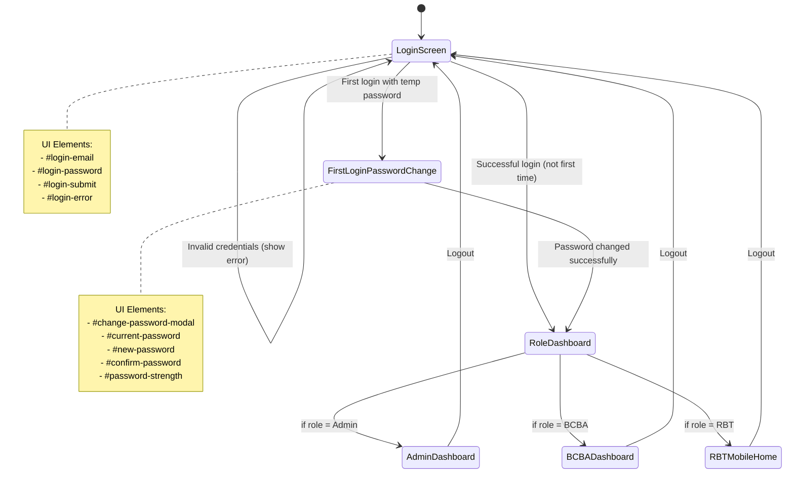
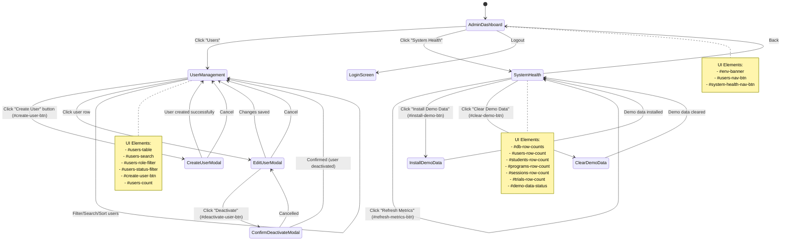
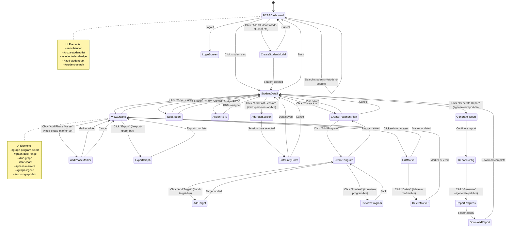
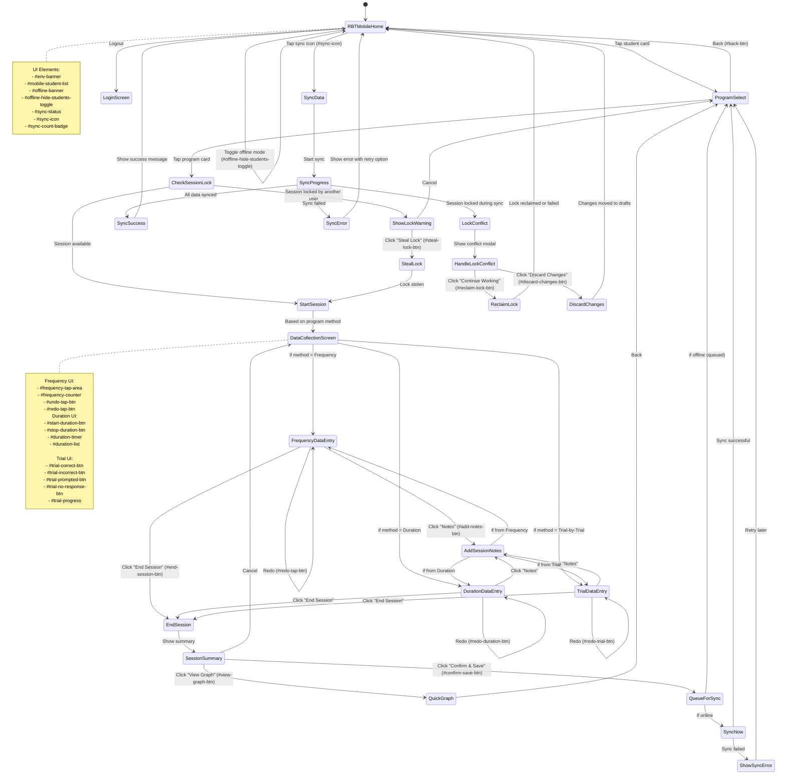
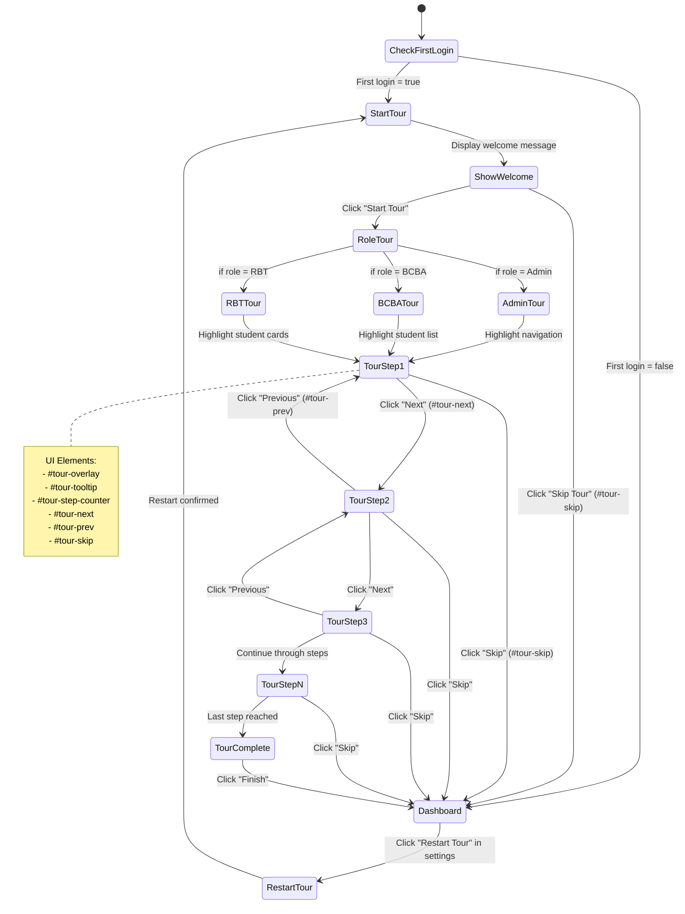
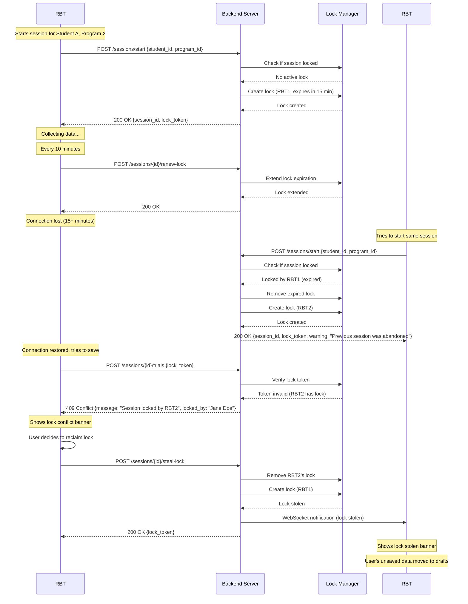
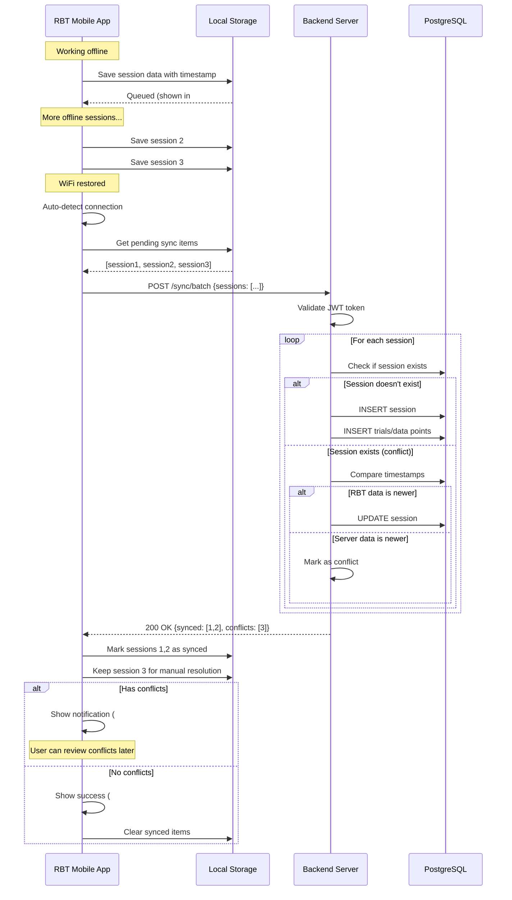
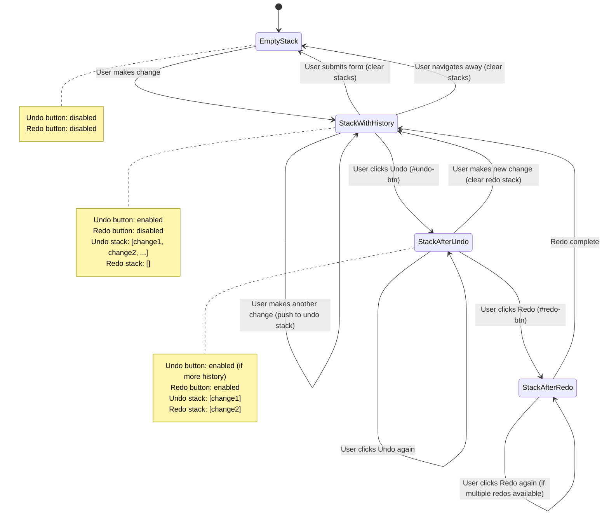
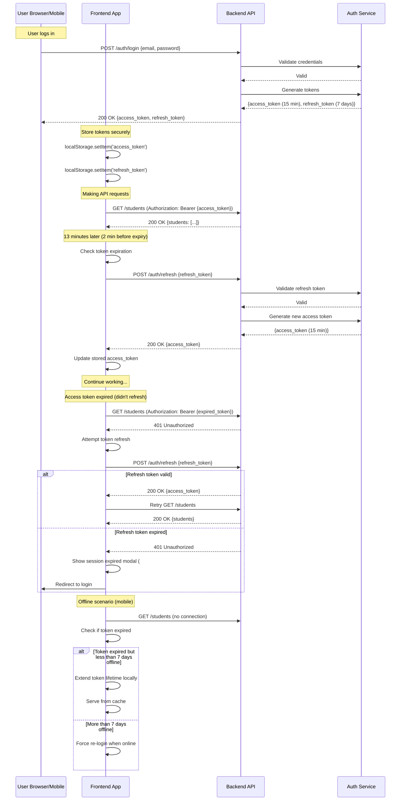

# ABA System - Screen Flow Diagrams

## Document Overview

This document contains screen flow diagrams showing navigation paths through the system for each user role. Diagrams use Mermaid syntax for rendering.

---

## Authentication Flow

---

## Admin User Flow

---

## BCBA User Flow

---

## RBT Mobile User Flow

---

## Guided Tour Flow

---

## Session Lock Management Flow

---

## Offline Sync Flow

---

## Undo/Redo State Management

---

## JWT Token Refresh Flow

---

**Next Steps:**
1. Review and approve screen flows
2. Create detailed UI mockups for each screen
3. Create data model/schema diagrams

---

**Document Version:** 1.0  
**Last Updated:** 2025-12-10  
**Status:** Draft - Awaiting Review
